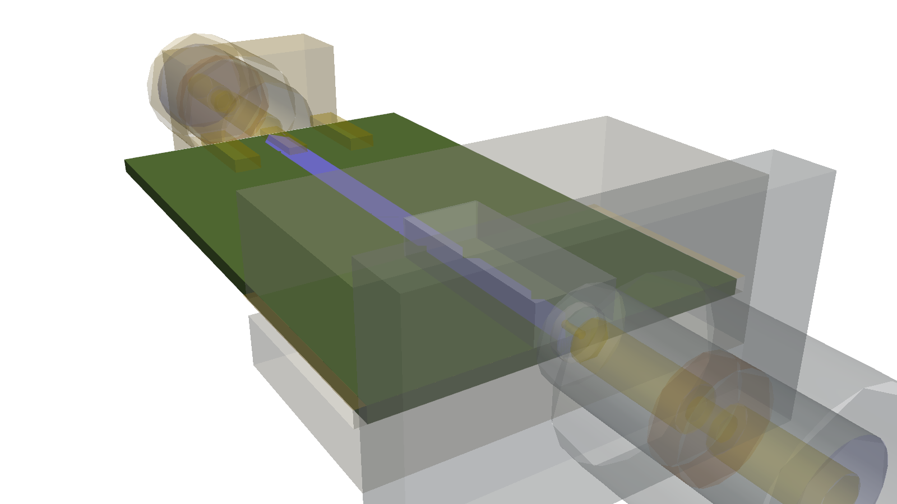
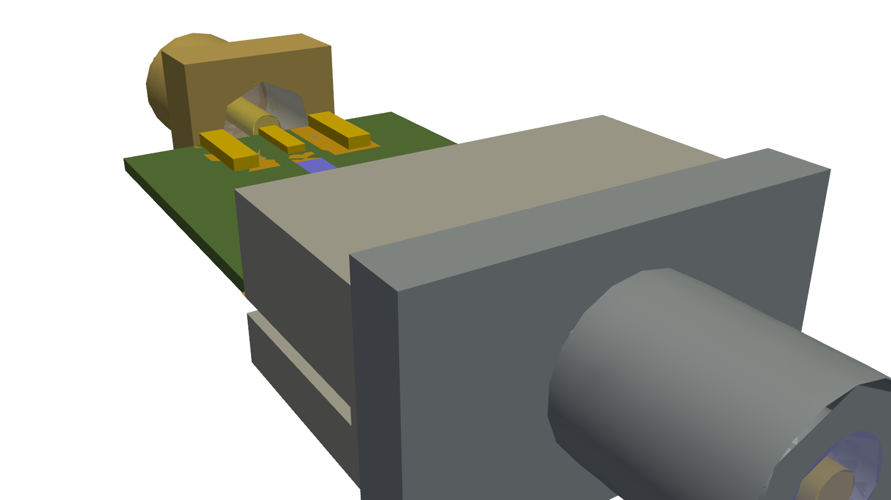

# hertzon-connectors: Edge-Launch-Steckverbinder für Hertzon (SMA, 2.92 mm, 2.4 mm)

Datenbank der PCB-Edge-Launch-Steckverbinder (End Launch) mit Links zu Datenblättern und 3D-Dateien,
detaillierte 3D-Modelle mit echtem Gewinde (Schritt 1) und vereinfachte, parametrische HF-Modelle mit
Materialien als native Hertzon-Projekte (Schritt 2).

> **2.5 mm:** Einen Standard-Koaxsteckverbinder mit 2.5 mm gibt es nicht. Gemeint ist sehr wahrscheinlich
> **2.4 mm** (50 GHz, IEEE 287 / IEC 61169-32). 2.4 mm steckt mit 1.85 mm zusammen, nicht mit SMA/2.92 mm.

## In Hertzon

Hertzon bringt die Bibliothek mit (`hertzon/model/data/edge_launch_connectors.json`, erzeugt aus diesem Repo).
Einen Stecker an einen Lumped Port an der Boardkante setzen: Port wählen, **Connectors › Real Connector**. Er
wird transparent angedeutet und lässt sich jederzeit zwischen *Ideal Port*, *Transition* (Übergang einmal in 3D
gelöst, im Circuit kaskadiert) und *Full 3D* umschalten, verlustfrei; *Flatten* ersetzt den Lumped Port
endgültig. Footprint nach den Southwest-Microwave-Application-Notes, mit Launch-Optimierung. Beschreibung:
[docs/CONNECTORS.md in Hertzon](https://github.com/c8501024/Hertzon/blob/dev/docs/CONNECTORS.md).

| Ideal Port (Stecker angedeutet) | Full 3D |
|---|---|
|  |  |

Nach einer Änderung an der Datenbank die Bibliothek in Hertzon neu schreiben (Pull Request auf `dev`):

```bash
python gen/connectors_db.py --hertzon /pfad/zu/Hertzon
```

## Inhalt

| Ordner / Datei | Inhalt |
|---|---|
| `data/connectors.json`, `data/connectors.csv` | 131 Teile (SMA 55, 2.92 mm 39, 2.4 mm 37): Hersteller, Teilenummer, Interface, Geschlecht, f_max, Montageart, Leiterplattendicke, Launch-Pin, Materialien, Datenblatt, Produktseite, STEP-/EM-Modell-Verfügbarkeit und Link, Herkunft der Angabe |
| `data/interfaces.json` | Interface-Maße nach Norm (Außenleiter-ID, Innenleiter, Gewinde, Steckerstift), Z0 und TE11-Grenzfrequenz, Dielektrika und Metalle mit εr / tan δ / σ und dem passenden Hertzon-Material, Perlen-Kompensation |
| `step/*.step` + `step/*.json` | Schritt 1: 8 detaillierte Modelle mit echtem Helix-Gewinde (1/4-36 UNS bzw. M7×0.75), geschlitzter Buchse, Stützperle, Launch-Pin, Block, Schrauben; das JSON nennt Körper-Index → Teil → Material und alle Maße (geschätzte Maße mit `_est`) |
| `preview/*.png` | Vorschau jedes Modells, Ansicht und Halbschnitt |
| `hzn/*_HF.hzn` | Schritt 2: vereinfachte HF-Modelle, parametrisch (Variablen `b`, `a`, `neck`, `bz`, `dp`, `dd`, `h`, `w`, `g` …), Wave Port am Koax-Referenzpunkt und an der GCPW-Leitung, Setup bei f_max, Sweep, S-Parameter-Report |
| `hzn/*_detailed.hzn` | die STEP-Körper als Import-Objekte mit Materialien (relativer Pfad `../step/…`, Ordner `hzn/` und `step/` nebeneinander lassen) |
| `sparams/*.s2p`, `sparams/overview.png` | S-Parameter der gelösten HF-Modelle (Hertzon/EMerge) |
| `gen/` | Generatoren: `connectors_db.py` (Datenbank), `geometry.py` (STEP), `hf_models.py` (Hertzon-Projekte), `render.py` (Vorschau) |

## Modelle

| Modell | Interface | Bauform (wie) | Board | f_max |
|---|---|---|---|---|
| `sma_legs_tab_jack_h1.57` | SMA | Lötbeine + Flachkontakt (Johnson 142-0701-801, Molex 73251-1150, Amphenol 132322) | 1.575 mm | 18 GHz |
| `k292_legs_tab_jack_h1.57` | 2.92 mm | Lötbeine (SV 1521-00002 / -60051) | 1.575 mm | 40 GHz |
| `k24_legs_tab_jack_h1.57` | 2.4 mm | Lötbeine (SV 1621-60050 / -60008) | 1.575 mm | 50 GHz |
| `sma_flange_block_jack_010_h0.508` | SMA (Super SMA) | Flansch + Klemmblock, Pin .010" (SWM 292-04A-12) | 0.508 mm | 27 GHz |
| `k292_flange_block_jack_010_h0.203` | 2.92 mm | SWM 1092-03A-12 | 0.203 mm | 40 GHz |
| `k292_flange_block_jack_005_h0.203` | 2.92 mm | SWM 1092-01A-12 | 0.203 mm | 40 GHz |
| `k24_flange_block_jack_007_h0.203` | 2.4 mm | SWM 1492-03A-12 | 0.203 mm | 50 GHz |
| `k24_flange_block_jack_005_h0.203` | 2.4 mm | SWM 1492-04A-12 | 0.203 mm | 50 GHz |

Die Flansch-Block-Bauform deckt auch Rosenberger 02K243-40ME3, Samtec 292-EL/240-EL, SV Solderless und
HUBER+SUHNER Edge Mount ab (gleiches Prinzip: Flansch, Klemme, Launch-Pin auf der Leiterbahn).

Koordinaten wie in Hertzon (mm): Board in der XY-Ebene, Oberseite Substrat bei z = 0, Board bei y > 0,
Boardkante bei y = 0, Steckerachse entlang −Y.

## Was genau ist und was geschätzt

* **Genau (Norm):** Außenleiter-ID, Innenleiter-AD, Steckerstift/Buchsenbohrung, Gewindeprofil und Steigung
  (SMA/2.92: 1/4-36 UNS-2A, 2.4: M7×0.75-6g). Daraus Z0: SMA 49.4 Ω (PTFE εr 2.05), 2.92 mm 49.9 Ω,
  2.4 mm 50.0 Ω (Luft). TE11-Grenze: SMA 24.7 GHz, 2.92 mm 45.5 GHz, 2.4 mm 55.4 GHz.
* **Genau (Katalog):** Southwest Microwave Launch-Pin / Dielektrikum: .010"/.0635", .007"/.039", .005"/.029";
  Materialien laut Datenblatt (Gehäuse CRES passiviert, Kontakt BeCu vergoldet, Perle Ultem 1000 / Kel-F,
  Block Messing vernickelt, Launch-Dielektrikum PTFE).
* **Geschätzt:** Körper, Flansch, Block, Beine, Perlenlage und -länge. Diese Maße stehen bei den Herstellern
  nur in Zeichnungen (Bilder). Sie liegen außerhalb des Feldes oder sind als Variable im HF-Modell änderbar.
  Für die herstellergenaue Außenkontur die Hersteller-STEP (Spalte `step_url`) importieren und das Innere
  (Koax, Perle, Launch) aus diesen Modellen nehmen.

### 50-Ω-Abschätzungen

* **Perle:** Mit unverändertem Außenleiter muss der Innenleiter in der Perle eingeschnürt werden:
  2.92 mm: Ultem (εr 3.15) → 0.665 mm, Kel-F (2.35) → 0.813 mm, PEEK (3.2) → 0.657 mm;
  2.4 mm: Ultem → 0.546 mm, Kel-F → 0.668 mm; SMA (PTFE-Leitung, Ultem-Perle) → 0.94 mm.
* **Launch-Abschnitt (SWM):** Pin in PTFE ergibt 77 Ω (.010"), 72 Ω (.007"), 74 Ω (.005"). Für 50 Ω bräuchte
  man εr ≈ 4.2–4.9 (Glas). Der hochohmige, kurze Abschnitt ist also gewollt: er kompensiert induktiv die
  Kapazität des Pins auf dem Pad.
* **Leitung:** GCPW auf RO4003C (εr 3.55). Offenes Board (Lötbein-Modelle): analytisch, h = 1.575 mm →
  w = 1.859 mm / g = 0.25 mm (SMA), w = 1.019 mm / g = 0.10 mm (2.92/2.4 mm); Hertzon bestätigt 50.0 Ω.
  Geschirmtes Modell (Flansch/Block, Via-Wände und Deckel): die analytische Breite ergab 45.4 Ω, deshalb mit
  zwei Lösungen je Board kalibriert: h = 0.203 mm → w = 0.330 mm, g = 0.15 mm; h = 0.508 mm → w = 0.755 mm,
  g = 0.25 mm.
* **Launch-Länge:** Der geschätzte 1.5-mm-Launch-Abschnitt (77 Ω) gab in Hertzon S11 = −12 dB bei 11 GHz.
  Auf 0.3 mm gekürzt, Pin 0.4 mm auf der Leiterbahn, Kanal w+2g+0.3 mm breit und max(0.4 mm, 2.5 h) hoch.
  Alles als Variable im Projekt (`Lw`, `Lover`, `wc`, `hc`) für eigene Abstimmung.

## Ergebnisse in Hertzon (EMerge FEM)

Alle 8 HF-Projekte bestehen Hertzons Modellprüfung. Gelöst mit `hertzon-cli solve` (adaptiv bis ΔS 0.02,
konvergiert nach 4–6 Pässen), Touchstone in `sparams/`, Übersicht `sparams/overview.png`:

| Modell | f_max | schlechtestes S11 | bei | min S21 |
|---|---|---|---|---|
| k292_flange_block_jack_010_h0.203 | 40 GHz | −18.7 dB | 8.8 GHz | −0.14 dB |
| k292_flange_block_jack_005_h0.203 | 40 GHz | −11.7 dB | 40 GHz | −0.44 dB |
| k24_flange_block_jack_007_h0.203 | 50 GHz | −14.8 dB | 50 GHz | −0.31 dB |
| k24_flange_block_jack_005_h0.203 | 50 GHz | −11.8 dB | 50 GHz | −0.46 dB |
| sma_flange_block_jack_010_h0.508 | 27 GHz | −13.5 dB | 27 GHz | −0.31 dB |
| sma_legs_tab_jack_h1.57 | 18 GHz | −22.1 dB | 18 GHz | −0.77 dB |

Einordnung:
* Das sind Ergebnisse der **geschätzten** Geometrie, keine Herstellerdaten. Die Hersteller geben z. B. RL ≥ 17 dB
  (HUBER+SUHNER) bzw. VSWR 1.15 (Samtec, ≈ −23 dB) an. Die dünnen Pins (.005") brauchen eine eigene
  Launch-Abstimmung (kürzer, schmalerer Kanal); die Variablen sind dafür da.
* `sma_legs_tab`: Die Radiation-Flächen liegen nah an der Leitung; das kostet schon bei 1 GHz ≈ 0.45 dB in S21.
  Für Verlustrechnungen `Hair` und `Wa` vergrößern.
* **2.92/2.4-mm-Lötbeine auf 1.575 mm:** Mit der generischen Flachkontakt-Geometrie funktioniert das nur bis
  ≈ 20 GHz (bei 40 GHz S11 ≈ −3.6 dB, mehrmodiger Port). Bei 40/50 GHz brauchen diese Teile das Footprint des
  Herstellers (SV schickt es auf Anfrage) oder ein dünnes Board. Die Lösung bei voller Bandbreite brauchte
  > 10 GB RAM und wurde hier abgebrochen; die Projekte sind trotzdem gültig und lösbar.

## HF-Vereinfachungen (Schritt 2)

* Negativ modelliert: nur die Feldvolumen (Koax-Luft/PTFE, Perle, Launch-Dielektrikum, Kanal, Substrat,
  Luft über der Leitung). Ihre Außenflächen sind das Metall (Perfect E, Hertzon-Standard).
* Gewinde, Schlitze, Fasen, Schraubenlöcher entfallen (außerhalb des Feldes oder < λ/50 bei f_max). Die
  Buchse wird ein voller Pin (die Steckebene ist der Port).
* Erhalten, weil sie S11 bestimmen: Perle mit Einschnürung, Stufe Koax → Launch, Pinlänge auf der Leiterbahn,
  Kanal über dem Launch, GCPW-Spalt und Masse, Via-Zaun.
* Innenleiter `gold` (≥ 1.27 µm Au sind > 1.6 Skintiefen ab 10 GHz). Für Einfügedämpfung den
  Koax-Außenflächen Finite Conductivity zuweisen (CRES 1.1e6 S/m, vergoldetes Messing wie Gold).
* Neue Projektmaterialien: `PTFE_connector` (2.05 / 0.0003), `Ultem_1000` (3.15 / 0.0025),
  `Kel-F_PCTFE` (2.35 / 0.005).

## 3D-Dateien der Hersteller

Direkt ladbar laut Herstellerseite: Amphenol SV 1521-00002, 1621-60050, 1621-60092 (STEP, dazu HFSS- und
CST-Modelle), Molex 73251-1150 (STEP-Zip). Auf Anfrage: Southwest Microwave (3D-Modelle, verschlüsselte
HFSS-Modelle), HUBER+SUHNER (HFSS). Mit Login im Konfigurator: Samtec. Nicht öffentlich gefunden: Rosenberger.
Die Links stehen in `data/connectors.csv` (`step_url`, `em_model`). Diese Umgebung konnte die Dateien selbst
nicht herunterladen (Downloads der Herstellerseiten sind hier gesperrt).

## Neu erzeugen

```bash
pip install gmsh numpy pyvista
python gen/connectors_db.py                         # --hertzon /pfad/zu/Hertzon: auch Hertzons Bibliothek
python gen/geometry.py
python gen/render.py
python gen/hf_models.py --hertzon /pfad/zu/Hertzon --validate
hertzon-cli solve hzn/k292_flange_block_jack_010_h0.203_HF.hzn -o sparams/   # optional
python gen/plot_sparams.py
```

## Lizenz

Code (`gen/`) unter GPL-2.0-or-later wie Hertzon; Daten und Modelle unter CC BY 4.0. Keine Herstellerdateien
enthalten; Marken gehören ihren Inhabern. Geschätzte Maße (`_est`, `origin: estimate`) sind keine
Herstellerangaben. Details in [LICENSE](LICENSE).
